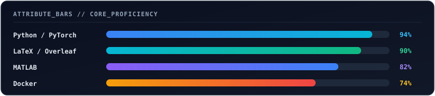

 

  
  
  
  
  
  

---

### 🧭 `ABOUT // RESEARCH_FOCUS`

> **Computational Imaging Researcher** specializing in **Spectral Compressive Imaging (CASSI)**, **Deep Unfolding Networks**, and **Inverse Problems** with deep learning.

| Attribute | Details |
| :--- | :--- |
| **Class** | Computational Imaging Researcher |
| **Specialization** | Spectral Reconstruction · Degradation-Aware Unfolding |
| **Guild** | Deep Learning Applications |
| **Signature** | `O^O` · `LVL. 99` |

---

### 📜 `PUBLICATIONS // COMPLETED_QUESTS`

| Quest | Paper & Authors | Venue | Links |
| :---: | :--- | :---: | :---: |
| **★ Q01** | **Degradation learning adaptive deep unfolding network for spectral compressive imaging** **Lei Liu**, Ping Xu, Xin Yuan, Chen Xu, Haifeng Zheng | *Pattern Recognition* `2026-07` |  |
| **★ Q02** | **Degradation-Aware Dynamic Fourier-Based Network for Spectral Compressive Imaging** | *IEEE TMM* `2024` |   |
| **★ Q03** | **A Refinement Boosted and Attention Guided Deep FISTA Reconstruction Framework for Compressive Spectral Imaging** | *IEEE TGRS* `2023` |   |

---

### 🎒 `TECH_STACK // EQUIPPED_ITEMS`

  

  
  
  
  
  
  

---

<b>Practice Makes Perfect</b> &nbsp;·&nbsp; <b>Keep Learning</b> &nbsp;·&nbsp; <b>Grow Every Day</b>

📧 <a href="mailto:liu_lei_98@163.com">liu_lei_98@163.com</a> &nbsp;|&nbsp; © 2026 Lei Liu &nbsp;|&nbsp; <code>O^O</code>

